```{=html}
<style>
:root {
  --accent: #73394f;
  --accent-dark: #512738;
  --accent-light: #f8eff3;
  --ink: #253041;
  --muted: #607080;
  --border: #e5e8ec;
}

body { color: var(--ink); }

.quarto-title-banner {
  background: linear-gradient(120deg, #512738, #8b455c) !important;
  padding-top: 2rem !important;
  padding-bottom: 2rem !important;
}

.quarto-title-banner .title, .quarto-title-banner .subtitle { 
  color: white !important; 
}

h1:not(.title) {
  color: var(--accent-dark);
  border-bottom: 2px solid #eadce3;
  padding-bottom: .45rem;
  margin-top: 2.4rem;
}

h2 { color: var(--accent); margin-top: 1.5rem; }
h3 { color: var(--accent-dark); }
p, li { line-height: 1.6; }

.section-card {
  border: 1px solid var(--border);
  border-left: 4px solid var(--accent);
  border-radius: 10px;
  padding: 1rem 1.2rem;
  margin: 1rem 0 1.4rem;
  background: white;
}

.prompt {
  background: var(--accent-light);
  border-radius: 8px;
  padding: .8rem 1rem;
  margin: .7rem 0;
}

.placeholder { color: var(--muted); font-style: italic; }

.workflow {
  display: flex; flex-wrap: wrap; gap: .45rem; align-items: center;
  margin: .8rem 0 1.2rem;
}

.workflow span {
  border: 1px solid #e2d3db; background: var(--accent-light);
  color: var(--accent-dark); border-radius: 20px; padding: .35rem .7rem;
  font-size: .85rem; font-weight: 600;
}

/* --- TOC Logo Styling --- */
#TOC {
  background-image: url("UCL_KUL_Logo.png");
  background-size: 150px;
  background-position: top left;
  background-repeat: no-repeat;
  padding-top: 120px !important;
}
</style>
```

```{=html}
<div class="workflow">
  <span>Literature</span> → <span>Data management</span> → <span>NCA</span> → <span>Covariates</span> → <span>Model proposal</span>
</div>
```

```{r setup-packages}
#| echo: false

#R Environment Setup

#Load all the necessary packages for the analysis
library(readxl)
library(dplyr)
library(tidyr)
library(ggplot2)
library(skimr)
library(visdat)
library(naniar)
library(GGally)
library(knitr)
library(kableExtra)
library(DiagrammeR)
```

```{r setup-data}
#| echo: false


#Read adjusted data file
data_file <- read.csv("Data/data_ug.csv")

#Read original data file
pa_data <- read_excel("Data/datIW1PMX006_CLEAN.xlsx")

#Copy data file as backup
data_NCA_backup <- data_file
pa_data_backup <- pa_data

```

For readability, code is not displayed in every section; however, all code remains available in the Quarto source file for full reproducibility.

# Study overview {.unlisted}

::: section-card
**Clinical Context & Drug Mechanism**<br> Bictegravir is an integrase strand transfer inhibitor (INSTI) used in combination antiretroviral therapy (cART) to treat HIV-1 and HIV-2. It inhibits HIV integrase, preventing viral DNA integration into the host genome and suppressing viral replication.

**Study Overview: Gajeevy Phase Ia SAD Trial**<br> This report evaluates data from a Phase Ia single ascending dose (SAD) study for **Gajeevy**, a novel investigational drug structurally and mechanistically similar to bictegravir.

**Design:** Four-arm, parallel-group study evaluating single oral doses (10 mg to 100 mg).<br> **Population:** 32 healthy volunteers.<br> **Objectives:** Assess safety and tolerability, explore the maximum tolerated dose (MTD), and perform an initial evaluation of the pharmacokinetic (PK) and pharmacodynamic (PD) properties of Gajeevy to guide dose selection for Phase II/III trials.<br>
:::

# Main objective {.unlisted}

::: section-card
The overarching objective of this integrative group work is to bridge clinical pharmacology, reproducible data management, and quantitative analysis. Specifically, the project is structured around three core pillars:

**1. Literature Research:** Conduct a comprehensive review of the clinical pharmacology of bictegravir, its mechanism of action as an integrase strand transfer inhibitor (INSTI), and the regulatory and clinical context of Phase I Single Ascending Dose (SAD) studies.<br> **2. FAIR Data Management & Cleaning:** Process, wrangle, and clean the raw dataset strictly adhering to the **FAIR data principles** (Findable, Accessible, Interoperable, and Reusable). This involves maintaining raw data integrity, documenting all data transformation steps transparently, and ensuring reproducible data pipelines in R.<br> **3. Primary Pharmacokinetic (PK) Analysis:** Execute a primary pharmacokinetic analysis on the cleaned dataset to evaluate the pharmacokinetic profile of Gajeevy, including concentration-time profiles and key parameters derived from appropriate quantitative approaches (such as Non-Compartmental Analysis and Compartmental Analysis).
:::

# 1. Bibliographic and contextual work

## 1.1 Literature review

::: section-card
Bictegravir (ATC code: J05AR20) is an integrase strand transfer inhibitor (INSTI) used in HIV treatment. It inhibits HIV integrase, preventing viral DNA integration into the host genome [@1; @2]. Although bictegravir exhibits potent antiviral activity on its own, it is administered as a fixed-dose combination with emtricitabine and tenofovir alafenamide, both nucleos(t)ide reverse transcriptase inhibitors (NRTIs) (Biktarvy) [@1; @2]. Combination antiretroviral therapy (cART) is essential, as HIV can rapidly develop resistance when a single antiretroviral drug is used alone, due to the virus's ability to mutate and generate resistant variants [@3]. By targeting different stages of viral replication, cART can suppress viral replication to undetectable levels, preserve immune function and prevent disease progression, but does not eradicate HIV from the body [@3; @4].

Bictegravir has a high genetic barrier to resistance. No treatment-emergent resistance was identified in 11 patients analysed through 144 weeks, although in vitro mutations M50I and R263K reduced susceptibility by 1.3-fold and 2.2-fold, respectively [@1].

Biktarvy effectively suppresses HIV replication. At week 48, 89–92% of previously untreated adults achieved HIV-1 RNA levels below 50 copies/mL, while viral suppression below this threshold was maintained in 98% (49/50) of adolescents who switched to Biktarvy [@1]. Bictegravir alone exhibits potent antiviral activity against HIV-1 (EC50: <0.05–6.6 nM) and HIV-2. Its protein-adjusted EC95 against wild-type HIV-1 is 361 nM (0.162 µg/mL) [@1; @2]. A trough concentration of 760 ng/mL (inhibitory quotient = 4.7) has been proposed as a reference threshold for adequate virological suppression in Phase III trials, although no clinically validated exposure target has been established [@2]. Similarly, no clinically validated upper exposure limit has been established. Bictegravir has a generally favourable safety profile, with the most frequently reported adverse effects being headache (5%), diarrhoea (5%) and nausea (4%) [@1].

Bictegravir is classified as a Biopharmaceutics Classification System (BCS) class II drug, characterised by low solubility and high permeability [@2; @5]. Its estimated oral bioavailability exceeds 61%, with dose linearity reported between 25 and 100 mg. Peak plasma concentrations are reached within 2–4 hours, and a moderate- or high-fat meal increases AUC by approximately 24% compared with the fasted state, without a clinically relevant effect [@2]. Bictegravir exhibits extensive plasma protein binding (>99%), with an unbound fraction of approximately 0.25% in vitro. It is primarily metabolised by CYP3A and UGT1A1 [@2]. Approximately 60.5% of a radiolabelled dose is recovered in faeces and 35% in urine, predominantly as metabolites; only 1.3% is excreted unchanged in urine [@2]. Renal excretion of unchanged bictegravir is therefore a minor elimination pathway. Bictegravir is also a substrate of P-glycoprotein (P-gp) and breast cancer resistance protein (BCRP) and has a plasma elimination half-life of approximately 17.3 hours [@2]. 
:::

## 1.2 Drug development context

::: section-card
The dataset originates from a Phase 1a single ascending dose (SAD) study investigating Gajeevy, an investigational drug with structural and mechanistic similarities to bictegravir. The study was designed as a four-arm, parallel-group study with oral administration. A total of 32 healthy volunteers received single doses ranging from 10 to 100 mg. The primary objectives were to assess safety and tolerability and, where applicable, explore the maximum tolerated dose [@6]. Secondary objectives included characterising the pharmacokinetic and pharmacodynamic properties of Gajeevy [@6]. The findings will inform dose selection for Phase II trials, which investigate preliminary efficacy, dose–response relationships and safety in patients [@6]. Phase III trials subsequently evaluate the drug's safety and efficacy in larger patient populations to confirm its benefit–risk profile before regulatory approval and market authorisation [@6].

The main objective of this research was to clean and explore the dataset, followed by an exploratory pharmacokinetic analysis of the drug. 
:::

## 1.3 Main pharmacokinetic challenges

::: section-card
- The co-administration of bictegravir with divalent cations (e.g., magnesium, iron, calcium and zinc) can significantly reduce its bioavailability [@2].

- As a result of co-administration with potent dual inhibitors or inducers of CYP3A4 and UGT1A1 (e.g., atazanavir, a protease inhibitor), clinically significant drug-drug interactions (DDI) are expected [@2].

- Pregnancy alters bictegravir pharmacokinetics. Despite evidence supporting its use during pregnancy, data on safety during breastfeeding and effects on infants remain limited [@1; @7].

- Bictegravir pharmacokinetics in adults aged 65 years and older remain insufficiently characterised, despite no clinically relevant age effect on exposure being identified in population pharmacokinetic analyses [@1]. 
:::

## 1.4 Main pharmacodynamic challenges

::: section-card
- As mentioned above, no clinically validated exposure target has been established due to the absence of a clear exposure–response relationship. The proposed threshold of 760 ng/mL is based on theoretical considerations and clinical observations [@2].

- Suboptimal adherence may lead to inadequate drug exposure and ongoing viral replication, potentially promoting the selection of resistant HIV variants. This may reduce bictegravir susceptibility and compromise long-term virological suppression. Therefore, maintaining treatment adherence is essential to preserve treatment efficacy [@1; @3].
:::

# 2. Data handling and management

Data exploration and anomaly screening have been completed. The dataset was examined visually and statistically using `glimpse()`, `summary()`, and distribution plots with `ggplot2` to identify potential outliers, typos, and missing values. All identified irregularities were logged and addressed in our Interim Analysis report.

## 2.1 Dataset Overview and Structure

The dataset was initially explored to understand its structure, identify the available variables, and assess the number of patients and pharmacokinetic observations.

### 2.1.1 Dataset Overview

```{r dataset-overview}
#| echo: false

pa_data |>
  summarise(
    Patients = n_distinct(ID),
    Measured_concentrations = sum(!is.na(`Conc_(ng/mL)`)),
    Analysis_variables = ncol(pa_data) - 2,
    Rows= n(),
    Columns = ncol(pa_data)
  ) |>
  knitr::kable(caption = "Dataset overview")

# One observation per patient for baseline analyses
patient_data <- pa_data |>
  distinct(ID, .keep_all = TRUE)

# Baseline variables: one observation per patient
baseline_vars <- c(
  "BW_(kg)", "AGE", "ALB_(g/L)",
  "CRP_(mg/L)", "CREAT_(mg/dL)"
)
```

### 2.1.2 Variable Summaries and Data Structure

Numerical and categorical variables were examined to summarize their distributions and identify potential inconsistencies. Categorical variables were summarized at the patient level to avoid counting repeated measurements from the same subject.

```{r skim-summary}
#| echo: false

skim_result <- skimr::skim(pa_data)
```

::: panel-tabset
## Numerical variables

```{r skim-numeric}
#| echo: false

skimr::yank(skim_result, "numeric")
```

## Categorical variables

```{r categorical-summary}
#| echo: false

pa_data |>
  distinct(ID, .keep_all = TRUE) |>
  select(SEX, ABCG2, UGT1A1, CYP3A5, ABCB1) |>
  mutate(across(everything(), as.character)) |>
  pivot_longer(everything(),
               names_to = "Variable",
               values_to = "Category") |>
  count(Variable, Category) |>
  knitr::kable(caption = "Patient-level categorical variables")
```

## Data structure

```{r data-structure}
#| echo: false

glimpse(pa_data)
```
:::

## 2.2 Data Preparation and Quality Assessment

Before performing pharmacokinetic analysis, dose variables, missing values, and data consistency were assessed to ensure that the dataset was suitable for subsequent analyses.

### 2.2.1 Dose Variable Preparation

The dose column records administration events. Zero values at subsequent sampling times indicate that no additional dose was administered. These values were recoded as NA for event-based analysis.

A separate patient-level dose variable was created to retain the administered dose across all observations.

```{r dose-handling}
pa_data <- pa_data |>
  arrange(ID, `TIME_(h)`) |>
  group_by(ID) |>
  mutate(
    DOSE_patient = first(`DOSE_(ng)`),
    `DOSE_(ng)` = na_if(`DOSE_(ng)`, 0),
    DOSE_mg = DOSE_patient / 1e6
  ) |>
  ungroup()


```

### 2.2.2 Missing Data Assessment

Missing values were visually assessed to identify their distribution across variables and observations.

Missing concentration values at time zero were distinguished from the dose values recoded as NA at sampling times without additional dosing events. These two types of missing entries have different interpretations and were not treated as equivalent data-quality problems.

```{r missing-visualization}
#| echo: false
#| fig-height: 5
#| fig-width: 9

naniar::vis_miss(pa_data)
```

The missing concentration records occur at time zero, where no baseline concentration measurements were recorded. The NA values in the dose column at subsequent sampling times represent the absence of additional dosing events rather than unknown administered doses.

### 2.2.3 Data Integrity and Consistency Checks

Patient records were assessed for duplicate sampling times, unexpected numbers of records or dosing events, and inconsistent baseline covariates.

```{r integrity-check}

patient_checks <- pa_data |>
  group_by(ID) |>
  summarise(
    Records = n(),
    Unique_times = n_distinct(`TIME_(h)`),
    Dosing_events = sum(`DOSE_(ng)` > 0, na.rm = TRUE),
    Covariates_consistent = all(c(
      n_distinct(`BW_(kg)`),
      n_distinct(AGE),
      n_distinct(`ALB_(g/L)`),
      n_distinct(`CRP_(mg/L)`),
      n_distinct(`CREAT_(mg/dL)`),
      n_distinct(SEX),
      n_distinct(ABCG2),
      n_distinct(UGT1A1),
      n_distinct(CYP3A5),
      n_distinct(ABCB1)
    ) == 1),
    .groups = "drop"
  )

flagged_records <- patient_checks |>
  filter(
    Records != 10 |
    Unique_times != Records |
    Dosing_events != 1 |
    !Covariates_consistent
  )

if (nrow(flagged_records) == 0) {
  cat("No patient-level integrity issues were flagged.")
} else {
  knitr::kable(flagged_records)
}
```

## 2.3 Exploratory Data Analysis and Outlier Screening

Exploratory analyses were performed to examine numerical distributions, identify potentially unusual observations, and investigate relationships among patient characteristics.

### 2.3.1 Variable Distribution

To explore the distribution of baseline characteristics, we used violin plots combined with boxplots and individual data points. Five continuous variables were examined: body weight, age, albumin, CRP, and serum creatinine. We used one observation per patient to avoid counting repeated measurements and grouped the results by sex.

```{r baseline-violin-plots}
#| echo: false
#| fig-width: 11
#| fig-height: 7

patient_data |>
  mutate(SEX = factor(SEX)) |>
  select(SEX, all_of(baseline_vars)) |>
  pivot_longer(
    cols = all_of(baseline_vars),
    names_to = "Variable",
    values_to = "Value"
  ) |>
  ggplot(aes(x = SEX, y = Value, fill = SEX)) +
  geom_violin(
    trim = FALSE,
    alpha = 0.5
  ) +
  geom_boxplot(
    width = 0.15,
    outlier.shape = NA
  ) +
  geom_jitter(
    width = 0.1,
    size = 0.5
  ) +
  scale_fill_brewer(palette = "Set1") +
  facet_wrap(
    ~Variable,
    scales = "free_y",
    ncol = 3
  ) +
  theme_minimal() +
  theme(
    legend.position = "none",
    strip.text = element_text(face = "bold")
  ) +
  labs(
    title = "Distribution of baseline covariates by sex",
    x = "Sex",
    y = "Value"
  )
```

These plots allow us to compare the spread and central tendency of each variable between sexes and identify potentially unusual values. The violin plots illustrate the estimated distribution, while the boxplots show the median and interquartile range. Individual points help us examine the actual observations, especially given the relatively small sample size.

This analysis provides an initial overview of variability in patient characteristics and helps identify values that may require further investigation. Any apparent differences between sexes should be interpreted cautiously, as this is an exploratory visualization rather than a formal statistical comparison.

### 2.3.2 Univariate Distribution Assessment

The distributions of continuous baseline covariates were examined using one observation per patient to avoid counting repeated measurements multiple times.

Concentration distributions were evaluated using all available concentration measurements to identify potential extreme values.

```{r missing-summary}
# Baseline variables: one observation per patient
baseline_vars <- c(
  "BW_(kg)", "AGE", "ALB_(g/L)",
  "CRP_(mg/L)", "CREAT_(mg/dL)"
)

baseline_long <- patient_data |>
  select(all_of(baseline_vars)) |>
  pivot_longer(
    everything(),
    names_to = "Variable",
    values_to = "Value"
  )

# Concentrations: all available observations
conc_long <- pa_data |>
  transmute(
    Variable = "Conc_(ng/mL)",
    Value = `Conc_(ng/mL)`
  ) |>
  filter(!is.na(Value))

# Combine and plot
bind_rows(baseline_long, conc_long) |>
  ggplot(aes(x = Value)) +
  geom_histogram(
    bins = 12,
    fill = "steelblue",
    color = "white"
  ) +
  facet_wrap(~Variable, scales = "free", ncol = 3) +
  theme_minimal() +
  labs(
    title = "Distribution of numerical variables",
    x = NULL,
    y = "Frequency"
  )
```

### 2.3.3 Concentration–Time Profile Assessment

Some high concentration values were observed during the initial exploration. Since drug concentrations depend on administered dose and sampling time, individual concentration–time profiles were examined separately by dose group to assess their pharmacokinetic plausibility.

```{r concentration-time}
#| echo: false
#| fig-height: 6
#| fig-width: 10

pa_data |>
  filter(!is.na(`Conc_(ng/mL)`)) |>
  ggplot(aes(
    x = `TIME_(h)`,
    y = `Conc_(ng/mL)`,
    group = ID
  )) +
  geom_line(alpha = 0.5) +
  geom_point(size = 0.8, alpha = 0.7) +
  facet_wrap(
    ~DOSE_mg,
    labeller = labeller(
      DOSE_mg = function(x) paste(x, "mg")
    )
  ) +
  scale_y_log10() +
  theme_minimal() +
  labs(
    title = "Individual concentration-time profiles by dose",
    x = "Time (h)",
    y = "Concentration (ng/mL, log scale)"
  )
```

### 2.3.4 Multivariate Outlier Screening

Potential multivariate outliers were investigated using pairwise scatter plots of patient-level covariates. This approach was used to identify unusual combinations of baseline characteristics that might not be apparent in individual variable distributions.

```{r pairwise-outliers}
#| echo: false
#| fig-height: 7
#| fig-width: 7

patient_data |>
  select(
    AGE,
    `BW_(kg)`,
    `CREAT_(mg/dL)`,
    `ALB_(g/L)`
  ) |>
  GGally::ggpairs()
```

## 2.4 Preparation of the Analysis-Ready Dataset

### 2.4.1 Unit Conversion and Data Export

Following data exploration and quality assessment, the dataset was prepared for subsequent Non-Compartmental Analysis (NCA) and Compartmental Analysis (CA).

To facilitate pharmacokinetic calculations and improve numerical readability, concentration values were converted from ng/mL to µg/mL, and dose values from ng to µg. A repeated-dose variable was also created to associate each subject's administered dose with all corresponding sampling times.

The resulting dataset was intended for use in downstream pharmacokinetic analyses.

```{r}
#| echo: false

library(readr)
library(readxl)
library(dplyr)

# 1. Read the cleaned raw dataset
data_wrong_dose <- read_excel("Data/datIW1PMX006_CLEAN.xlsx")

# 2. Calculate the repeated/maximum dose per subject ID
data_ug <- data_wrong_dose %>%
    group_by(ID) %>%
    mutate(`DOSE_(ng)_repeated` = max(`DOSE_(ng)`)) %>%
    ungroup()

# 3. Convert concentrations from ng/mL to ug/mL
data_ug <- data_ug %>%
  mutate(`Conc_(ng/mL)` = `Conc_(ng/mL)` / 1000) %>%
  rename(`Conc_(ug/mL)` = `Conc_(ng/mL)`)

# 4. Convert doses from ng to ug
data_ug <- data_ug %>%
  mutate(`DOSE_(ng)` = `DOSE_(ng)` / 1000) %>%
  rename(`DOSE_(ug)` = `DOSE_(ng)`)

# 5. Convert repeated doses from ng to ug
data_ug <- data_ug %>%
  mutate(`DOSE_(ng)_repeated` = `DOSE_(ng)_repeated` / 1000) %>%
  rename(`DOSE_(ug)_repeated` = `DOSE_(ng)_repeated`)

# 6. FAIR Principle: Export the processed, analysis-ready dataset securely
#write_csv(data_ug, "Data/datIW1PMX006_UG.csv")
```

## 2.5 Data Management Plan (FAIR)

The Data Management Plan for Gajeevy’s Phase Ia SAD study has been developed in accordance with the FAIR principles. The proposed strategy aims to improve data findability through structured documentation, ensure accessibility through controlled access, promote interoperability using standardised data formats and variable definitions, and support reusability through traceable data processing and reproducible pharmacokinetic analyses.

The implementation of these measures will be documented and verified throughout the project, while respecting participant confidentiality and the company’s intellectual property requirements.

**The complete Data Management Plan is available here:**

[View Data Management Plan (PDF)](DMP.pdf)

# 3. Pharmacokinetic analysis

## 3.1 Non-compartmental analysis (NCA)

**Aim:** Define and document the analytical settings, integration methods, and acceptance criteria used for the non-compartmental pharmacokinetic analysis (NCA) of Gajeevy.

### 3.1.1 NCA Settings & Acceptance Criteria

| Parameter / Setting | Specification | Description / Target |
|:-----------------------|:-----------------------|:-----------------------|
| **Administration Route** | EV | Extravascular administration route |
| **Integration Method** | Linear up / Log down | Trapezoidal rule optimization for ascending/descending phases |
| **Adjusted** $R^2$ | $\ge 0.98$ | Minimum threshold for terminal elimination regression fit |
| **Extrapolated** $\text{AUC}$ | $\le 20\%$ | Maximum allowable percentage of extrapolated area |
| **SPAN Criterion** | $\ge 3$ | Minimum ratio of observation period to estimated half-life in terminal phase |

### 3.1.2 Methodology & Workflow

A non-compartmental analysis was performed on our cleaned dataset using `PKAnalix2024R1`. The area under the curve ($\text{AUC}$) was calculated by integrating consecutive segments of the concentration–time curve using the **linear-up/log-down method**. This method more accurately reflects underlying pharmacokinetic behavior and is widely adopted in regulatory guidance and clinical reports.

- **Linear Trapezoidal Rule:** Applied to increasing or constant concentrations, as absorption phases are not straightforwardly described by a single exponent.
- **Log-Linear Trapezoidal Rule:** Applied to decreasing positive concentrations to appropriately capture the exponential decline typical of the elimination phase.

### 3.1.3 Quality Control and Reliability Assessment

The reliability of the NCA results was evaluated using three core acceptance criteria: an adjusted $R^2$ of at least $0.98$ for the terminal elimination regression, a maximum extrapolated $\text{AUC}$ fraction of $20\%$, and a SPAN criterion of at least three half-lives within the terminal phase.

- **Regression Evaluation:** The adjusted $R^2$ served as the primary statistical metric, paired with visual inspections of concentration–time plots to confirm a plausible terminal elimination phase.
- **Lambda-z (**$\lambda_z$) Estimation: Five data points were initially selected for the estimation of $\lambda_z$, while aiming to maximize $R^2$.
- **Handling of Deviations:** When acceptance criteria were not met, data points were reassessed and alternative subsets were evaluated based on regression fit and pharmacokinetic plausibility. Estimates failing to meet the criteria were documented and interpreted with appropriate caution.

### 3.1.4 Individual Patient Terminal Phase Optimization Log

To ensure optimal estimation of the terminal elimination rate constant ($\lambda_z$), individual concentration–time profiles were evaluated. When standard criteria required deviation from the initial five-point selection, adjustments were documented as follows:

- **Patient 5:** Four data points were selected because the fifth point corresponded to $C_{\text{max}}$, marking the transition between the absorption and elimination phases.
- **Patient 6:** Four data points were selected for the same reason, as the fifth point corresponded to $C_{\text{max}}$ and therefore did not belong to the terminal elimination phase.
- **Patient 7:** Three data points were selected, yielding an adjusted $R^2$ of $0.976$. Although five data points could technically be included, none of the tested subsets met the acceptance criterion of $R^2 \ge 0.98$. The three-point subset provided the highest $R^2$ among the evaluated options while representing the minimum acceptable number of points.
- **Patient 13:** Four data points were selected because the fifth point corresponded to $C_{\text{max}}$, marking the transition between the absorption and elimination phases.
- **Patient 14:** Four data points were selected because including the fifth point resulted in an adjusted $R^2$ below the acceptance criterion of $0.98$.
- **Patient 21:** Four data points were selected because the fifth point corresponded to $C_{\text{max}}$, marking the transition between the absorption and elimination phases.
- **Patient 23:** Four data points were selected because the fifth point corresponded to $C_{\text{max}}$ and did not belong to the terminal elimination phase. The resulting adjusted $R^2$ was $0.973$, remaining slightly below the acceptance criterion of $0.98$.
- **Patient 31:** Four data points were selected because including the fifth point resulted in an adjusted $R^2$ below the acceptance criterion of $0.98$.

### 3.1.5 Individual Concentration–Time Profiles and Terminal Fits

The individual concentration–time profiles and estimated terminal elimination slopes ($\lambda_z$) for all 32 subjects evaluated in PKanalix 2024R1 are presented below. Each tab displays the terminal phase regression fits for four subjects.

::::::::::: panel-tabset
## Subjects 1–4

::: {#fig-nca-individual-fits-1}
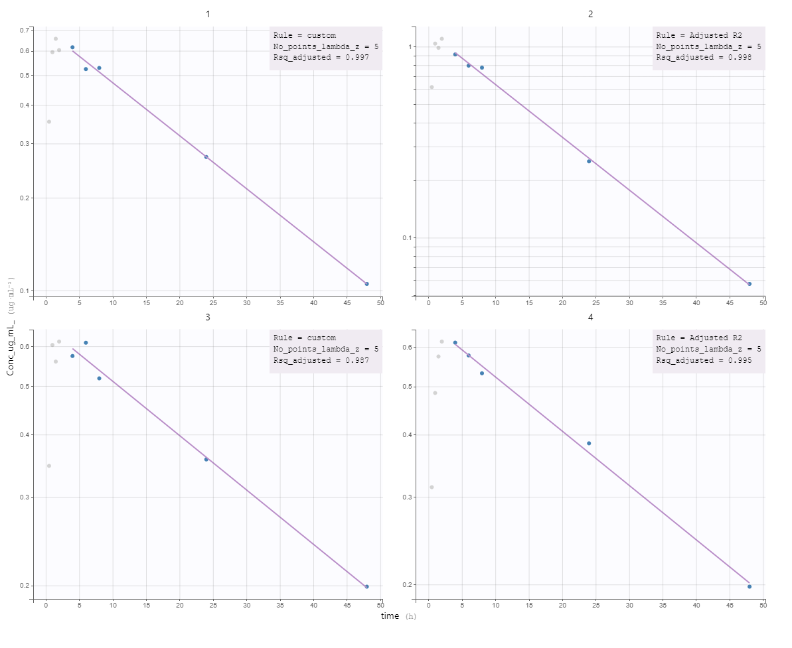

Terminal elimination phase regression fits for Subjects 1 to 4.
:::

## Subjects 5–8

::: {#fig-nca-individual-fits-2}
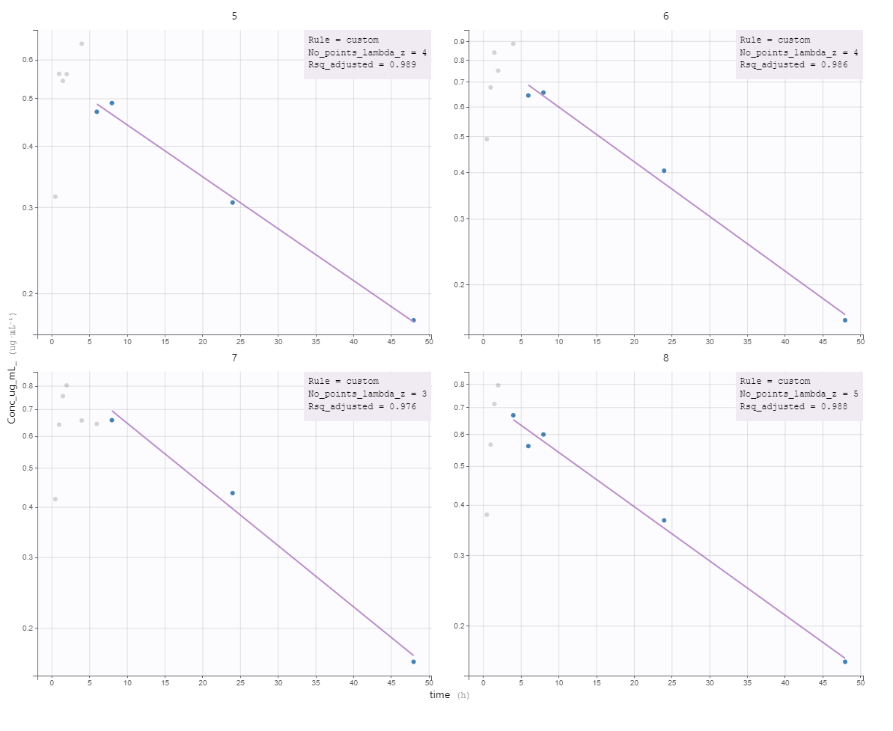

Terminal elimination phase regression fits for Subjects 5 to 8.
:::

## Subjects 9–12

::: {#fig-nca-individual-fits-3}
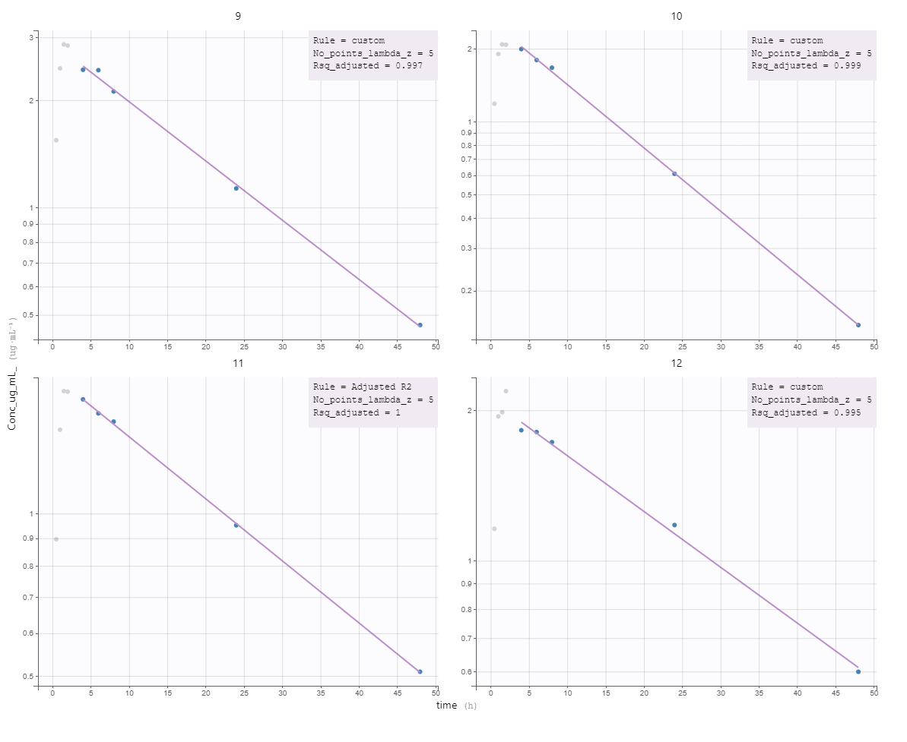

Terminal elimination phase regression fits for Subjects 9 to 12.
:::

## Subjects 13–16

::: {#fig-nca-individual-fits-4}
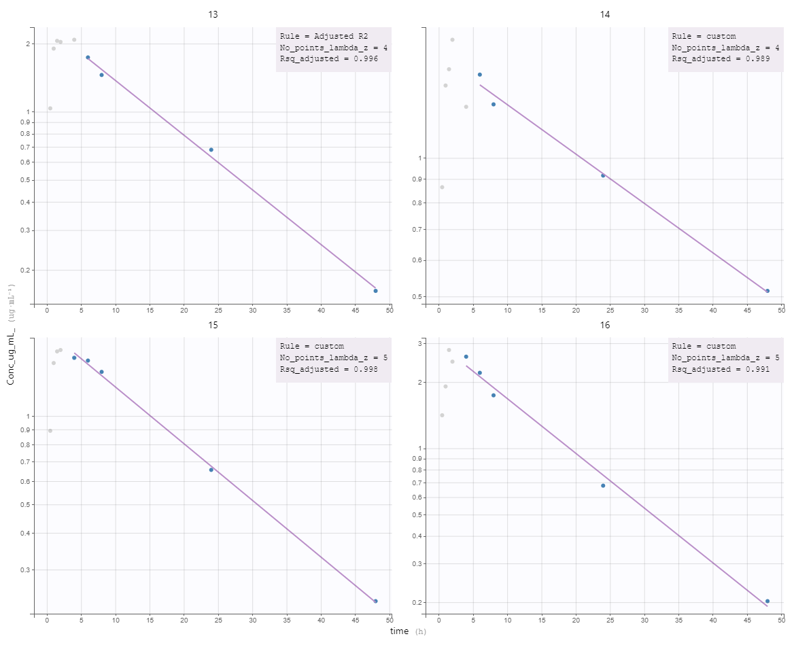

Terminal elimination phase regression fits for Subjects 13 to 16.
:::

## Subjects 17–20

::: {#fig-nca-individual-fits-5}
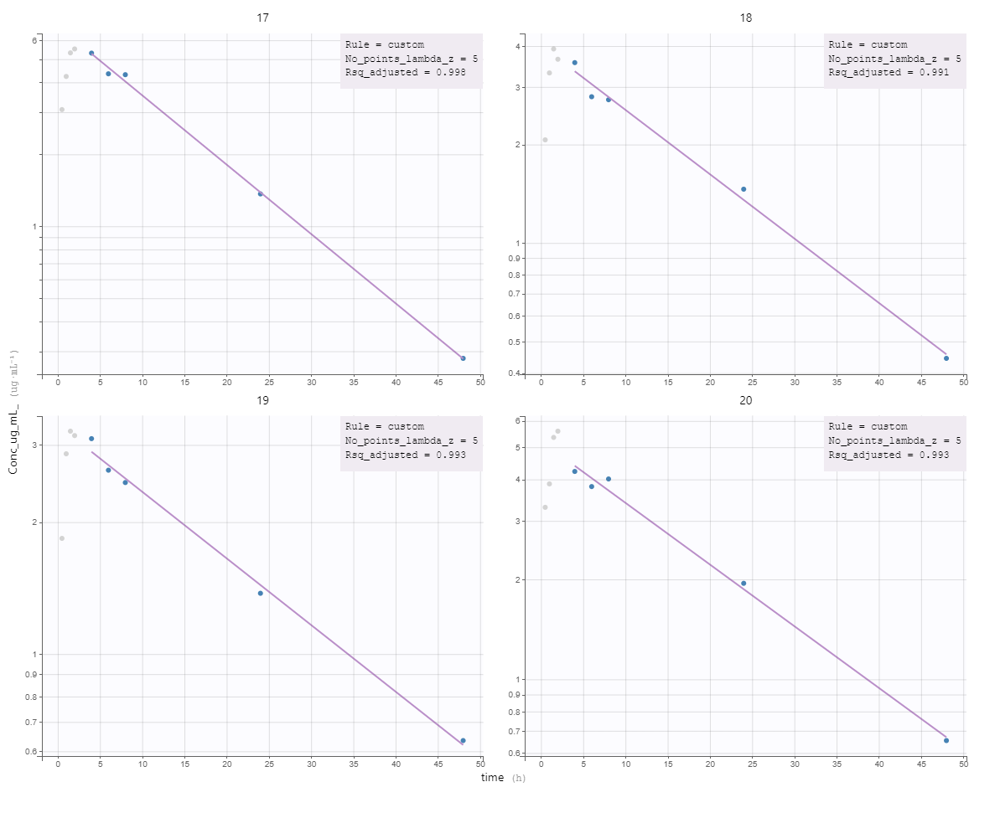

Terminal elimination phase regression fits for Subjects 17 to 20.
:::

## Subjects 21–24

::: {#fig-nca-individual-fits-6}
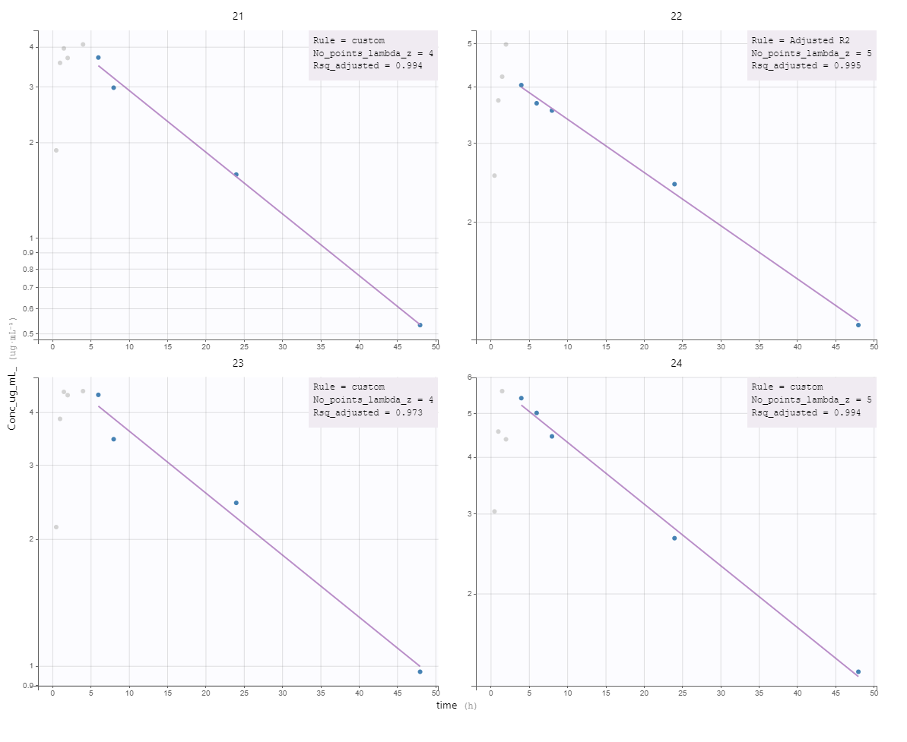

Terminal elimination phase regression fits for Subjects 21 to 24.
:::

## Subjects 25–28

::: {#fig-nca-individual-fits-7}
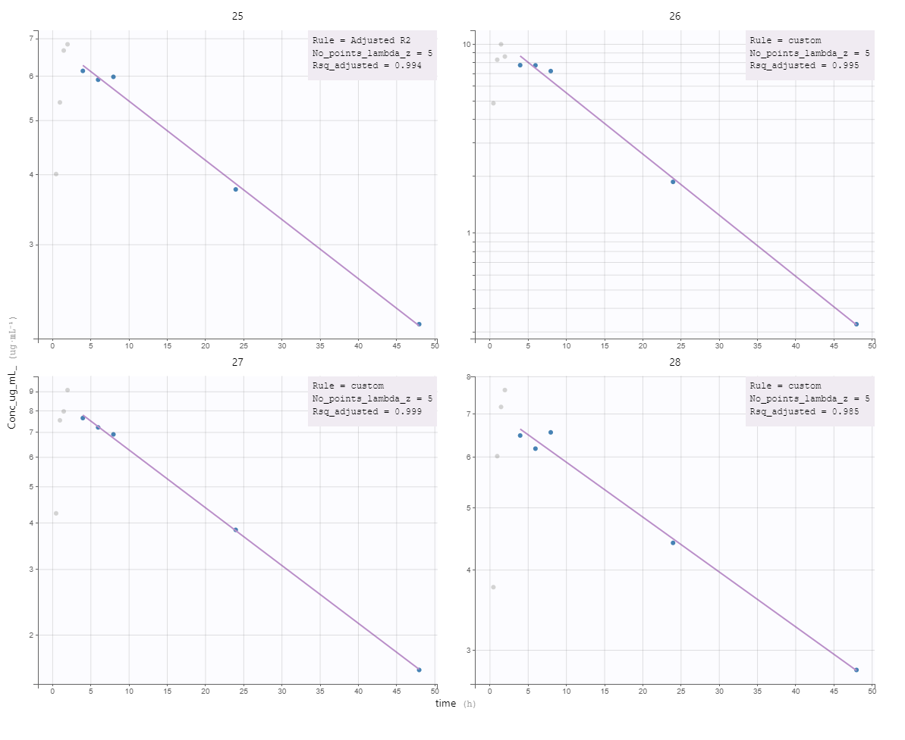

Terminal elimination phase regression fits for Subjects 25 to 28.
:::

## Subjects 29–32

::: {#fig-nca-individual-fits-8}
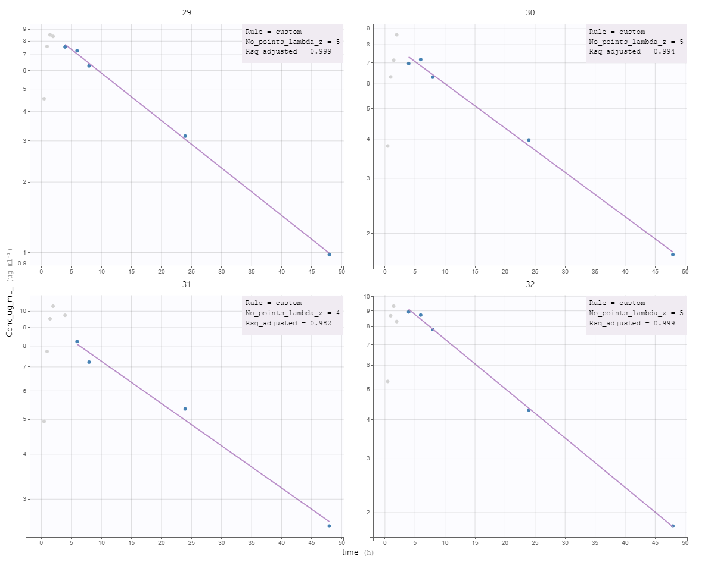

Terminal elimination phase regression fits for Subjects 29 to 32.
:::
:::::::::::

## 3.2 Derive and summarize PK parameters

```{r}
#| echo: false

nca_data <- read_excel(
  "Data/Data NCA.xlsx")

```

The individual PK parameters were summarized using the mean, standard deviation, median, and interquartile range. The complete individual NCA results are also presented.

```{r nca-parameter-summary111}
#| include: false

pk_parameters <- c(
  "Cmax (ug/mL)",
  "Tmax (h)",
  "AUC0-tlast (h.ug/ml)",
  "AUC0-inf (h.ug/ml)",
  "T1/2 (h)",
  "kel (1/h)",
  "CL/F (mL/h)",
  "Vd/F (mL)"
)

pk_summary <- nca_data |>
  select(all_of(pk_parameters)) |>
  pivot_longer(
    everything(),
    names_to = "Parameter",
    values_to = "Value"
  ) |>
  group_by(Parameter) |>
  summarise(
    N = sum(!is.na(Value)),
    Mean = round(mean(Value, na.rm = TRUE), 2),
    SD = round(sd(Value, na.rm = TRUE), 2),
    Median = round(median(Value, na.rm = TRUE), 2),
    Q1 = round(quantile(Value, 0.25, na.rm = TRUE), 2),
    Q3 = round(quantile(Value, 0.75, na.rm = TRUE), 2),
    .groups = "drop"
  ) |>
  mutate(
    Parameter = factor(Parameter, levels = pk_parameters)
  ) |>
  arrange(Parameter)
```

::: panel-tabset
## Summary

```{r nca-summary-table222}
#| echo: false

knitr::kable(
  pk_summary,
  align = "ccccccc",
  caption = "Descriptive summary of NCA parameters"
)
```

## Individual NCA Data

```{r nca-individual-data222}
#| echo: false

knitr::kable(
  nca_data,
  align = rep("c", ncol(nca_data)),
  digits = 2,
  caption = "Individual NCA results for all patients"
)
```
:::

## 3.3 Covariate Analysis of PK Parameters

To investigate potential relationships between patient characteristics and pharmacokinetic (PK) parameters, an exploratory covariate analysis was performed using individual parameters estimated from non-compartmental analysis (NCA).

Five continuous covariates (age, body weight, albumin, creatinine, and CRP) were assessed using Spearman's rank correlation, with correlation coefficients (ρ) and corresponding p-values reported. Scatterplots were also generated to visualize these relationships.

Categorical covariates, including sex and four genetic polymorphisms (ABCB1, ABCG2, CYP3A5, and UGT1A1), were explored using boxplots with individual observations. Dose groups were distinguished by color to help identify potential dose-related patterns.

These analyses were considered exploratory and were intended to identify potential covariate relationships for further investigation.

```{r prepare-pk-covariates}
#| include: false

library(dplyr)
library(tidyr)
library(ggplot2)
library(knitr)

# Prepare data for covariate analysis
nca_cov <- nca_data |>
  mutate(
    Dose_mg = DOSE_ug_repeated / 1000,
    Dose_group = factor(Dose_mg),

    Cmax_per_mg = `Cmax (ug/mL)` / Dose_mg,
    AUC_last_per_mg = `AUC0-tlast (h.ug/ml)` / Dose_mg,
    AUC_inf_per_mg = `AUC0-inf (h.ug/ml)` / Dose_mg
  )

# Continuous covariates
continuous_covars <- c(
  "AGE",
  "BW_kg_",
  "ALB_g_L_",
  "CREAT_mg_dL_",
  "CRP_mg_L_"
)

# PK parameters
pk_parameters <- c(
  "Cmax (ug/mL)",
  "Tmax (h)",
  "AUC0-inf (h.ug/ml)",
  "T1/2 (h)",
  "kel (1/h)",
  "CL/F (mL/h)",
  "Vd/F (mL)"
)

# Readable covariate names for plots
cov_labels <- c(
  "Age (years)",
  "Body weight (kg)",
  "Albumin (g/L)",
  "Creatinine (mg/dL)",
  "CRP (mg/L)"
)
```

```{r pk-covariate-correlations.}
#| include: false

library(dplyr)
library(tidyr)
library(knitr)

# PK parameters
pk_parameters <- c(
  "Cmax (ug/mL)",
  "Tmax (h)",
  "AUC0-inf (h.ug/ml)",
  "T1/2 (h)",
  "kel (1/h)",
  "CL/F (mL/h)",
  "Vd/F (mL)"
)

# Continuous covariates
continuous_covars <- c(
  "AGE",
  "BW_kg_",
  "ALB_g_L_",
  "CREAT_mg_dL_",
  "CRP_mg_L_"
)

# Covariate labels
cov_labels <- c(
  "Age (years)",
  "Body weight (kg)",
  "Albumin (g/L)",
  "Creatinine (mg/dL)",
  "CRP (mg/L)"
)

# Reshape data
corr_long <- nca_cov |>
  select(
    id, Dose_group,
    all_of(continuous_covars),
    all_of(pk_parameters)
  ) |>
  pivot_longer(
    cols = all_of(continuous_covars),
    names_to = "Covariate",
    values_to = "X"
  ) |>
  pivot_longer(
    cols = all_of(pk_parameters),
    names_to = "PK_parameter",
    values_to = "Y"
  ) |>
  mutate(
    Covariate = factor(
      Covariate,
      levels = continuous_covars,
      labels = cov_labels
    )
  )

# Calculate Spearman correlations
cor_results <- corr_long |>
  group_by(PK_parameter, Covariate) |>
  group_modify(~{
    d <- .x |>
      filter(is.finite(X), is.finite(Y))

    if (
      nrow(d) < 4 ||
      n_distinct(d$X) < 2 ||
      n_distinct(d$Y) < 2
    ) {
      return(tibble(
        N = nrow(d),
        rho = NA_real_,
        p_value = NA_real_
      ))
    }

    test <- suppressWarnings(
      cor.test(
        d$X, d$Y,
        method = "spearman",
        exact = FALSE
      )
    )

    tibble(
      N = nrow(d),
      rho = unname(test$estimate),
      p_value = test$p.value
    )
  }) |>
  ungroup() |>
  mutate(
    Plot_label = paste0(
      "rho = ", sprintf("%.2f", rho),
      "\np = ", format.pval(p_value, digits = 2)
    )
  )

# Function to display results for each PK parameter
show_cor <- function(parameter) {

  cor_results |>
    filter(PK_parameter == parameter) |>
    select(Covariate, N, rho, p_value) |>
    mutate(
      rho = round(rho, 2),
      p_value = format.pval(p_value, digits = 3)
    ) |>
    knitr::kable(
      caption = paste("Spearman correlation:", parameter)
    , align = "cccc")
}
```

### 3.3.1 Spearman Correlation Analysis of Continuous Covariates

The following tables present Spearman's correlation coefficients (ρ) and corresponding p-values for each pharmacokinetic parameter and continuous covariate.

::: panel-tabset
## Cmax

```{r}
#| echo: false
show_cor("Cmax (ug/mL)")
```

## Tmax

```{r}
#| echo: false
show_cor("Tmax (h)")
```

## AUC₀–∞

```{r}
#| echo: false
show_cor("AUC0-inf (h.ug/ml)")
```

## Half-life

```{r}
#| echo: false
show_cor("T1/2 (h)")
```

## Elimination rate constant

```{r}
#| echo: false
show_cor("kel (1/h)")
```

## CL/F

```{r}
#| echo: false
show_cor("CL/F (mL/h)")
```

## Vd/F

```{r}
#| echo: false
show_cor("Vd/F (mL)")
```
:::

### 3.3.2 Visualization of Continuous Covariate Relationships

Scatterplots were used to visualize the relationships between individual PK parameters and continuous patient covariates. Patients were colored according to their administered dose. Spearman's correlation coefficient (ρ) and the corresponding p-value are displayed for each relationship.

```{r prepare-correlation-plots}
#| include: false

library(ggplot2)
library(dplyr)

# Function to plot each PK parameter
plot_pk_cov <- function(parameter) {

  plot_data <- corr_long |>
    filter(
      PK_parameter == parameter,
      is.finite(X),
      is.finite(Y)
    )

  plot_stats <- cor_results |>
    filter(PK_parameter == parameter)

  ggplot(plot_data, aes(x = X, y = Y)) +
    geom_point(
      aes(color = Dose_group),
      size = 2.3,
      alpha = 0.85
    ) +
    geom_smooth(
      method = "lm",
      formula = y ~ x,
      se = FALSE,
      color = "black",
      linetype = "dashed",
      linewidth = 0.6
    ) +
    geom_label(
      data = plot_stats,
      aes(
        x = -Inf,
        y = Inf,
        label = Plot_label
      ),
      inherit.aes = FALSE,
      hjust = 0,
      vjust = 1,
      size = 3,
      fill = "white",
      label.size = 0
    ) +
    facet_wrap(
      ~Covariate,
      scales = "free_x",
      ncol = 3
    ) +
    theme_bw() +
    theme(
      strip.text = element_text(face = "bold"),
      legend.position = "bottom"
    ) +
    labs(
      title = paste("Covariate relationships:", parameter),
      x = NULL,
      y = parameter,
      color = "Dose (mg)"
    )
}
```

::: panel-tabset
## Cmax

```{r plot-cmax}
#| echo: false
#| fig-width: 11
#| fig-height: 7

plot_pk_cov("Cmax (ug/mL)")
```

## Tmax

```{r plot-tmax}
#| echo: false
#| fig-width: 11
#| fig-height: 7

plot_pk_cov("Tmax (h)")
```

## AUC₀–∞

```{r plot-auc}
#| echo: false
#| fig-width: 11
#| fig-height: 7

plot_pk_cov("AUC0-inf (h.ug/ml)")
```

## Half-life

```{r plot-half-life}
#| echo: false
#| fig-width: 11
#| fig-height: 7

plot_pk_cov("T1/2 (h)")
```

## Elimination rate constant

```{r plot-kel}
#| echo: false
#| fig-width: 11
#| fig-height: 7

plot_pk_cov("kel (1/h)")
```

## CL/F

```{r plot-cl}
#| echo: false
#| fig-width: 11
#| fig-height: 7

plot_pk_cov("CL/F (mL/h)")
```

## Vd/F

```{r plot-vd}
#| echo: false
#| fig-width: 11
#| fig-height: 7

plot_pk_cov("Vd/F (mL)")
```
:::

### 3.3.3 Exploratory Analysis of Sex and Genetic Polymorphisms

The relationships between pharmacokinetic parameters and categorical patient covariates, including sex and genetic polymorphisms, were explored using boxplots. Individual observations were overlaid and colored according to the administered dose to visualize variability between groups.

```{r prepare-categorical-plots}
#| include: false

library(dplyr)
library(tidyr)
library(ggplot2)

categorical_covars <- c(
  "SEX", "ABCB1", "ABCG2",
  "CYP3A5", "UGT1A1"
)

# Prepare categorical data
cat_long <- nca_cov |>
  select(
    id, Dose_group,
    all_of(categorical_covars),
    all_of(pk_parameters)
  ) |>
  mutate(
    across(all_of(categorical_covars), as.character)
  ) |>
  pivot_longer(
    cols = all_of(categorical_covars),
    names_to = "Covariate",
    values_to = "Category"
  ) |>
  pivot_longer(
    cols = all_of(pk_parameters),
    names_to = "PK_parameter",
    values_to = "Value"
  )

# Function to plot categorical covariates
plot_cat_cov <- function(parameter) {

  cat_long |>
    filter(
      PK_parameter == parameter,
      !is.na(Category),
      is.finite(Value)
    ) |>
    ggplot(aes(x = Category, y = Value)) +
    geom_boxplot(
      fill = "lightgrey",
      outlier.shape = NA
    ) +
    geom_jitter(
      aes(color = Dose_group),
      width = 0.12,
      height = 0,
      size = 2,
      alpha = 0.8
    ) +
    facet_wrap(
      ~Covariate,
      scales = "free_x",
      ncol = 3
    ) +
    theme_bw() +
    theme(
      strip.text = element_text(face = "bold"),
      legend.position = "bottom"
    ) +
    labs(
      title = paste("Categorical covariates:", parameter),
      x = "Category",
      y = parameter,
      color = "Dose (mg)"
    )
}
```

::: panel-tabset
## Cmax

```{r cat-cmax}
#| echo: false
#| fig-width: 11
#| fig-height: 7
#| warning: false

plot_cat_cov("Cmax (ug/mL)")
```

## Tmax

```{r cat-tmax}
#| echo: false
#| fig-width: 11
#| fig-height: 7
#| warning: false

plot_cat_cov("Tmax (h)")
```

## AUC₀–∞

```{r cat-auc}
#| echo: false
#| fig-width: 11
#| fig-height: 7
#| warning: false

plot_cat_cov("AUC0-inf (h.ug/ml)")
```

## Half-life

```{r cat-half-life}
#| echo: false
#| fig-width: 11
#| fig-height: 7
#| warning: false

plot_cat_cov("T1/2 (h)")
```

## Elimination rate constant

```{r cat-kel}
#| echo: false
#| fig-width: 11
#| fig-height: 7
#| warning: false

plot_cat_cov("kel (1/h)")
```

## CL/F

```{r cat-cl}
#| echo: false
#| fig-width: 11
#| fig-height: 7
#| warning: false

plot_cat_cov("CL/F (mL/h)")
```

## Vd/F

```{r cat-vd}
#| echo: false
#| fig-width: 11
#| fig-height: 7
#| warning: false

plot_cat_cov("Vd/F (mL)")
```
:::

### 3.3.4 Summary of Covariate analysis

```{r covariate-summary}
#| echo: false
#| results: asis

cov_summary <- cor_results |>
  filter(!is.na(rho), !is.na(p_value)) |>
  ungroup() |>
  mutate(
    p_BH = p.adjust(p_value, method = "BH")
  )

if (nrow(cov_summary) > 0) {
  nominal <- cov_summary |>
    filter(p_value < 0.05)

  cat(
    "A total of", nrow(cov_summary),
    "Spearman correlations were evaluated.",
    nrow(nominal),
    "had unadjusted p-values below 0.05, and",
    sum(cov_summary$p_BH < 0.05),
    "remained below 0.05 after Benjamini-Hochberg",
    "adjustment.\n\n"
  )

  if (nrow(nominal) > 0) {
    nominal |>
      arrange(p_value) |>
      transmute(
        `PK parameter` = PK_parameter,
        Covariate,
        N,
        rho = round(rho, 2),
        `p-value` = signif(p_value, 3),
        `BH-adjusted p` = signif(p_BH, 3)
      ) |>
      knitr::kable(
        caption = "Exploratory correlations with unadjusted p < 0.05"
      ) |>
      print()
  }
}
```

> Continuous covariates

Spearman correlation analysis was performed to investigate relationships between five continuous covariates and seven NCA-derived PK parameters. The analysis evaluated the strength and direction of these relationships, while scatterplots were used to visualize individual variability and possible trends.

Among the 35 correlations evaluated, five had unadjusted p-values below 0.05, of which two remained statistically significant after Benjamini–Hochberg adjustment. The strongest positive correlation was observed between body weight and Vd/F (ρ = 0.55, p = 0.00108, adjusted p = 0.0377), suggesting that individuals with higher body weight tended to have a larger apparent volume of distribution. A significant negative correlation was also identified between age and CL/F (ρ = −0.52, p = 0.00232, adjusted p = 0.0405), indicating a tendency toward lower apparent clearance with increasing age.

Additional correlations were observed between body weight and the elimination rate constant (ρ = −0.41), body weight and half-life (ρ = 0.40), and age and half-life (ρ = 0.35). However, these associations did not remain statistically significant after adjustment for multiple comparisons.

> Categorical covariates

The boxplots were used to explore differences in PK parameters between sexes and across four genetic polymorphisms (ABCB1, ABCG2, CYP3A5, and UGT1A1). These visualizations allowed the comparison of individual variability and the distribution of PK parameters across different categories, while also considering the administered dose.

> Overall interpretation

The exploratory analysis identified body weight and age as potential covariates influencing pharmacokinetic variability, particularly apparent volume of distribution and apparent clearance, respectively.

However, given the limited sample size (32 individuals), multiple comparisons, and possible influence of administered dose, these findings should be interpreted cautiously and do not establish causal relationships.

The observed associations provide a basis for selecting candidate covariates for further evaluation in population pharmacokinetic modeling, where their effects can be investigated while accounting for other sources of variability.

# 3.4 Comparison of Gajeevy and Bictegravir PK Parameters

The individual non-compartmental analysis (NCA) results were summarized separately for each single-dose group. Values are reported as **median \[Q1–Q3\]**, using one NCA record per participant. The table is calculated from the original exported NCA data rather than manually transcribing the summary.

```{r nca-ext-prepare}
#| include: false
library(readxl)
library(dplyr)
library(tidyr)
library(ggplot2)
library(knitr)

# In the main dashboard, nca_data is already read in Section 3.2.
# This fallback also allows this section to be reused elsewhere.
if (!exists("nca_data")) {
  nca_data <- readxl::read_excel("Data/Data NCA.xlsx")
}

# Existing NCA export uses DOSE_ug_repeated (micrograms).
dose_candidates <- c("DOSE_ug_repeated", "DOSE_(ug)_repeated", "DOSE_mg")
dose_col <- intersect(dose_candidates, names(nca_data))
if (length(dose_col) == 0) {
  stop("Dose column not found. Check the NCA file's dose column name.")
}
dose_col <- dose_col[1]

nca_extended <- nca_data |>
  mutate(
    Dose_mg = if (dose_col == "DOSE_mg") {
      as.numeric(.data[[dose_col]])
    } else {
      as.numeric(.data[[dose_col]]) / 1000
    }
  )

# Alternative column spellings are permitted, without changing units.
parameter_candidates <- list(
  "AUC0-inf"   = c("AUC0-inf (h.ug/ml)", "AUC0-inf (h.ug/mL)", "AUC0-inf"),
  "AUC0-tlast" = c("AUC0-tlast (h.ug/ml)", "AUC0-tlast (h.ug/mL)", "AUC0-tlast"),
  "CL/F"       = c("CL/F (mL/h)", "CL/F"),
  "Clast"      = c("Clast (ug/mL)", "Clast (ug/ml)", "Clast"),
  "Cmax"       = c("Cmax (ug/mL)", "Cmax (ug/ml)", "Cmax"),
  "T1/2"       = c("T1/2 (h)", "T1/2"),
  "Tlast"      = c("Tlast (h)", "Tlast"),
  "Tmax"       = c("Tmax (h)", "Tmax"),
  "Vd/F"       = c("Vd/F (mL)", "Vd/F"),
  "kel"        = c("kel (1/h)", "kel")
)

first_existing <- function(candidates, col_names) {
  hits <- candidates[candidates %in% col_names]
  if (length(hits) == 0) NA_character_ else hits[1]
}

matched_cols <- vapply(
  parameter_candidates, first_existing, character(1),
  col_names = names(nca_extended)
)
required <- c("AUC0-inf", "AUC0-tlast", "CL/F", "Cmax", "T1/2", "Tmax", "Vd/F", "kel")
missing_required <- intersect(required, names(matched_cols)[is.na(matched_cols)])
if (length(missing_required) > 0) {
  stop("NCA file is missing these expected PK parameters: ",
       paste(missing_required, collapse = ", "))
}
missing_optional <- names(matched_cols)[is.na(matched_cols)]
if (length(missing_optional) > 0) {
  warning("Optional parameter(s) absent and not tabulated: ",
          paste(missing_optional, collapse = ", "))
}
matched_cols <- matched_cols[!is.na(matched_cols)]

nca_long_extended <- nca_extended |>
  select(Dose_mg, all_of(unname(matched_cols))) |>
  pivot_longer(
    cols = all_of(unname(matched_cols)),
    names_to = "Original_variable", values_to = "Value"
  ) |>
  mutate(
    Parameter = names(matched_cols)[match(Original_variable, matched_cols)],
    Value = as.numeric(Value)
  )

nca_dose_n <- nca_extended |> count(Dose_mg, name = "n_subjects")

nca_dose_stats <- nca_long_extended |>
  group_by(Dose_mg, Parameter) |>
  summarise(
    N = sum(is.finite(Value)),
    Median = if (N > 0) median(Value, na.rm = TRUE) else NA_real_,
    Q1 = if (N > 0) unname(quantile(Value, 0.25, na.rm = TRUE)) else NA_real_,
    Q3 = if (N > 0) unname(quantile(Value, 0.75, na.rm = TRUE)) else NA_real_,
    Mean = if (N > 0) mean(Value, na.rm = TRUE) else NA_real_,
    SD = if (N > 1) sd(Value, na.rm = TRUE) else NA_real_,
    .groups = "drop"
  )

# Helpers for automatically writing the accompanying interpretation.
overall_stats <- nca_long_extended |>
  group_by(Parameter) |>
  summarise(
    N = sum(is.finite(Value)),
    Mean = mean(Value, na.rm = TRUE),
    SD = sd(Value, na.rm = TRUE),
    Median = median(Value, na.rm = TRUE),
    Q1 = unname(quantile(Value, 0.25, na.rm = TRUE)),
    Q3 = unname(quantile(Value, 0.75, na.rm = TRUE)),
    .groups = "drop"
  )

get_overall <- function(parameter, field) {
  overall_stats |> filter(Parameter == parameter) |> pull(all_of(field)) |> first()
}
get_dose_median <- function(parameter, dose_mg) {
  nca_dose_stats |>
    filter(Parameter == parameter, Dose_mg == dose_mg) |>
    pull(Median) |> first()
}
fmt_num <- function(x) sprintf("%.2f", x)
```

```{r nca-ext-table-by-dose}
#| echo: true
#| results: asis

parameter_order <- names(parameter_candidates)

dose_display <- nca_dose_stats |>
  left_join(nca_dose_n, by = "Dose_mg") |>
  mutate(
    `Dose group` = paste0(Dose_mg, " mg (n=", n_subjects, ")"),
    `Median [Q1–Q3]` = sprintf("%.2f [%.2f – %.2f]", Median, Q1, Q3),
    Parameter = factor(Parameter, levels = parameter_order)
  ) |>
  select(Parameter, `Dose group`, `Median [Q1–Q3]`) |>
  pivot_wider(names_from = `Dose group`, values_from = `Median [Q1–Q3]`) |>
  arrange(Parameter)

knitr::kable(
  dose_display,
  caption = "Gajeevy NCA parameters by single oral dose: median [Q1–Q3]."
)
```

The non-compartmental analysis of Gajeevy included 32 healthy volunteers receiving single oral doses of 10, 25, 50 or 100 mg. The results provide an initial understanding of the drug's absorption, exposure, distribution and elimination.

**Absorption:** The median T~max~ is 2.00 h \[1.50–2.00\], indicating that Gajeevy generally reaches its highest plasma concentration approximately two hours after administration. This suggests a relatively early concentration peak, although the extent of oral bioavailability remains unknown.

**Systemic exposure:** The mean C~max~ is 4.09 ± 3.18 µg/mL, while the mean AUC~0–inf~ is 117.18 ± 101.41 h·µg/mL. These values show considerable variability in drug exposure. However, because participants received different doses, part of this variability is expected to result from the study design. Comparing the four dose groups separately would help determine whether exposure increases proportionally with dose.

**Elimination:** Gajeevy has a mean terminal half-life of 20.12 ± 6.51 h and a mean terminal elimination rate constant of 0.04 ± 0.01 h⁻¹. These findings indicate that plasma concentrations decline relatively slowly during the terminal phase. This could make once-daily administration worth investigating, but repeated-dose studies are needed to confirm whether effective concentrations can be maintained over 24 hours.

**Clearance and distribution:** The mean apparent oral clearance is 436.38 ± 109.48 mL/h, and the mean apparent volume of distribution is 11.89 ± 2.52 L. Since absolute oral bioavailability is unknown, these parameters cannot be interpreted as the true clearance or volume of distribution of Gajeevy.

**Reliability of exposure estimates:** The mean AUC~0–inf~ (117.18 h·µg/mL) is higher than the mean AUC~0–tlast~ (92.16 h·µg/mL). This difference indicates that part of the total exposure was estimated beyond the last measured concentration. The reliability of this estimation should be checked using individual extrapolated AUC percentages.

### 3.4.1 Quantitative comparison: 50 mg group Gajeevy vs RCP

```{r}
#| label: rcp-50mg
rcp_50 <- tribble(
  ~Parameter,  ~`Observed values for 50 mg`, ~RCP,
  "T1/2",      "17.96 h",                    "17.3 h",
  "Tmax",      "2.00 h",                     "2.0 - 4 h",
  "Cmax",      "4.73 µg/mL",                 "6.15 µg/mL",
  "AUC0-inf",  "110.56 µg·h/mL",             "102 µg·h/mL"
)
kable(rcp_50)
```

### 3.4.2 Test 1: Relation between k~el~ and T~1/2~

$$T_{1/2} = \frac{\ln 2}{k_{el}}$$

```{r}
#| label: test1
kel_50 <- 0.04
t_half <- log(2) / kel_50
t_half
```

T~1/2~ = ln2 / 0.04 = **`r round(t_half, 1)` h**. This matches exactly with the T~1/2~ of the RCP (17.3 h). So, the k~el~ derived perfectly reproduces the official half-life of bictegravir.

### 3.4.3 Test 2: Relation between CL/F and AUC

$$CL/F = \frac{Dose}{AUC}$$

```{r}
#| label: test2
dose_ug   <- 50000
cl_gaj    <- dose_ug / 110.56
cl_rcp    <- dose_ug / 102
c(Gajeevy = cl_gaj, RCP = cl_rcp)
```

CL/F = 50000 µg / 110.56 = **`r round(cl_gaj, 2)` mL/h**.

From the RCP, for the 50000 µg dose and AUC of 102 µg·h/mL, we have a CL/F of `r round(cl_rcp, 1)` mL/h.

This still falls within the confidence for Gajeevy (335.10 - 516.94). So, this is also a solid validation for our derived parameters.

### 3.4.5 Dose-Proportionality (Linearity) Assessment

**Dose-normalized AUC calculation (from the table)**

The multiple dose pharmacokinetics of bictegravir are dose proportional over the dose range of 25 to 100 mg. Dose proportionality helps predict drug exposure when the dose changes and is consistent with linear pharmacokinetics over the studied dose range. We can assess dose proportionality by comparing dose-normalized AUC values (AUC/dose) across groups.

```{r}
#| label: dose-prop
dose_prop <- tibble(
  Dose     = c(10, 25, 50, 100),
  AUC0_inf = c(24.35, 57.34, 110.56, 264.12)
) |>
  mutate(`AUC/Dose (ratio)` = AUC0_inf / Dose,
         Dose = paste(Dose, "mg")) |>
  rename(`AUC0-inf` = AUC0_inf)

kable(dose_prop, digits = 2)
```

**Interpretation:** The ratios remain within a relatively stable range (2.2 – 2.6). This is consistent with the RCP statement (dose-proportional linearity between 25 and 100 mg).

### 3.4.6 Vd/F for the 50 mg group

The Vd/F for Gajeevy is 10727.32 mL, which falls within the reference range (10,900 - 11,200 mL). This supports the structural validity of our derived parameter. [@ekobena_population_2025]

## 4 Compartmental modelling

**Aim**: Develop a preliminary compartmental model to describe the pharmacokinetics of Gajeevy following single-dose oral administration and compare alternative model structures.

A compartmental analysis (CA) was performed on our clean dataset in PKAnalix2024R1.

NCA provided an initial overview of the pharmacokinetic characteristics of Gajeevy following oral administration, without assuming a specific compartmental model. The observed concentration-time profiles of Gajeevy (@fig-Gajeevy-concentration-time-profiles), together with the NCA-derived parameters, were subsequently used to guide the selection of a preliminary compartmental model.

Model selection was based on the goodness of fit and information criteria, taking into account the trade-off between model complexity and descriptive performance.

```{r}
#| label: fig-Gajeevy-concentration-time-profiles
#| eval: true
#| fig-cap: "Concentration-time profiles following the oral administration of Gajeevy on both linear and log scale."

#load necessary packages
library(ggplot2)
library(patchwork)

#load data
data_CA <- data_file
# Plot 1: Linear scale
p1 <- ggplot(data_CA, aes(
  x = TIME_.h.,
  y = Conc_.ug.mL.,
  group = ID
)) +
  geom_line(
    color = "#0072B2",
    alpha = 0.45,
    linewidth = 0.5
  ) +
  stat_summary(
    aes(group = 1),
    fun = mean,
    geom = "line",
    color = "black",
    linewidth = 1.2
  ) +
  scale_x_continuous(
    breaks = seq(0, 50, by = 10),
    limits = c(0, 50),
    expand = expansion(mult = c(0, 0))
  ) +
  scale_y_continuous(
    breaks = seq(0, 10, by = 2.5),
    limits = c(0, 10),
    expand = expansion(mult = c(0, 0))
  ) +
  labs(
    title = "Linear scale",
    x = "Time (h)",
    y = expression(Concentration~(mu*g/mL))
  ) +
  theme_bw(base_size = 12) +
  theme(
    plot.title = element_text(size = 14, hjust = 0.5),
    axis.title = element_text(size = 12),
    panel.grid.minor = element_line(color = "#EEEEEE"),
    panel.grid.major = element_line(color = "#D9D9D9")
  )

# Plot 2: Logarithmic scale
p2 <- ggplot(data_CA, aes(
  x = TIME_.h.,
  y = Conc_.ug.mL.,
  group = ID
)) +
  geom_line(
    color = "#0072B2",
    alpha = 0.45,
    linewidth = 0.5
  ) +
  stat_summary(
    aes(group = 1),
    fun = mean,
    geom = "line",
    color = "black",
    linewidth = 1.2
  ) +
  scale_x_continuous(
    breaks = seq(0, 50, by = 10),
    limits = c(0, 50),
    expand = expansion(mult = c(0, 0))
  ) +
  scale_y_log10(
    breaks = c(0.1, 1, 10),
    limits = c(0.05, 15),
    expand = expansion(mult = c(0, 0))
  ) +
  labs(
    title = "Log scale",
    x = "Time (h)",
    y = expression(Concentration~(mu*g/mL))
  ) +
  theme_bw(base_size = 12) +
  theme(
    plot.title = element_text(size = 14, hjust = 0.5),
    axis.title = element_text(size = 12),
    panel.grid.minor = element_line(color = "#EEEEEE"),
    panel.grid.major = element_line(color = "#D9D9D9")
  )

# Combine both plots
combined_plot <- (p1 | p2)
combined_plot
```

### 4.1 Compartment selection and evaluation

### 4.1.1 Initial model selection

NCA provided an initial overview of the pharmacokinetic characteristics of Gajeevy following oral administration, without assuming a specific compartmental model. The observed concentration–time profiles (@fig-Gajeevy-concentration-time-profiles-per_dose), together with the NCA-derived parameters (Section 3.1), were subsequently used to guide the selection of a preliminary compartmental model. The concentration–time profile supports the selection of an oral one-compartment model with first-order absorption and elimination. A characteristic oral absorption pattern is observed, with concentrations increasing exponentially from the first sampling point at 0.5 hours to a peak concentration at approximately 2 hours, followed by a gradual decline [@9]. This resembles a linear absorption process from the gastrointestinal tract into the systemic circulation, as no clear plateau is observed before Tmax and Cmax [@9]. Subsequently AUC appears to increase approximately proportionally with dose (@fig-Gajeevy-concentration-time-profiles-per_dose; Section 3.1). These observations suggest dose-proportional pharmacokinetics and support the use of a one-compartment model with first-order absorption [@9]. As no data were available before the first sampling point, no absorption lag time was included, keeping the model as simple as possible without introducing an additional parameter unsupported by the available data. The post-peak decline appears approximately linear on the semi-logarithmic scale from 2 to 48 hours, which is consistent with first-order elimination. Finally, the absence of an obvious inflection point indicating a distinct distribution phase supports the use of a one-compartment model as a reasonable starting point.

### 4.1.2 Comparing a two-compartment system

However, when we look at the concentration-time curves per dose, we see a slight bend (inflection point) between 4 and 8 hours after dosing in all dose groups. This could indicate a two-compartment system, in which the drug distributes into a second compartment [@9]. When we fit this model to our data, the two-compartment model yields a lower -2LL (-532.8 versus -442.7), and thus a better raw fit to the data (@tbl-ca-model-comparison) [@9]. This is consistent with the fact that models with more parameters can always follow the data at least as closely, so -2LL rewards additional parameters, even when these mainly capture noise. Akaike Information Criterion (AIC) and Bayesian Information Criterion (BIC), however, also correct for model complexity by penalizing each additional parameter (AIC = -2LL + 2 × number of parameters; BIC = -2LL + ln(n) × number of parameters), so that a model only wins if it improves the fit by more than the penalty costs [@9]. Because each individual was fitted separately, the two-compartment model has 64 more parameters than the one-compartment model (161 versus 97), and this additional complexity is not justified by the gain in fit: both the AIC (-248.7 versus -210.8) and the BIC (-226.1 versus -175.6) are lower for the one-compartment model (@tbl-ca-model-comparison). The slight bend observed between 4 and 8 hours may reflect variability or noise in the data rather than a true distribution phase. The two-compartment model, being more flexible, can follow this deviation, but the data do not support a distinct second compartment. The preliminary one-compartment model is therefore the simpler and more reliable choice, and it describes the data adequately. This was further supported by the observed-versus-predicted plot (@fig-observed-versus-predicted-plot), which showed no clear curvature or trend indicating systematic over- or underestimation of concentrations. A schematic representation of the model structure is shown in (@fig-sketch-model). 

```{r}
#| label: fig-Gajeevy-concentration-time-profiles-per_dose
#| eval: true
#| fig-cap: "Concentration-time profiles separated on dose following the oral administration of Gajeevy on log scale."

dose_plot <- ggplot(data_CA, aes(x = TIME_.h., y = Conc_.ug.mL., group = ID, color = factor(DOSE_.ug._repeated))) +
  geom_line(
    aes(group = ID),
    alpha = 0.40,
    linewidth = 0.5
  ) +
  stat_summary(
    aes(group = factor(DOSE_.ug._repeated)),
    fun = mean,
    geom = "line",
    color = "black",
    linewidth = 1.2
  ) +
  scale_y_log10() +
  scale_color_brewer(palette = "Set1", name = "Dose (µg)") +
  theme_light() +
  labs(
    title = "Concentration-time profiles by dose on log scale",
    x = "Time (h)",
    y = "Concentration (µg/L, log scale)"
  )
dose_plot
```

```{r}
#| label: tbl-ca-model-comparison
#| eval: true
#| tbl-cap: "Fit criteria for one- and two-compartment models"

model_comparison <- data.frame(
  Criterion = c(
    "Total cost",
    "-2 Log-likelihood (-2LL)",
    "Akaike Information Criterion (AIC)",
    "Bayesian Information Criterion (BIC)",
    "Number of estimated parameters"
  ),
  `One-compartment model` = c(
    1.16, -442.72, -248.72, -226.13, 97
  ),
  `Two-compartment model` = c(
    0.85, -532.77, -210.77, -175.55, 161
  ),
  check.names = FALSE
)

knitr::kable(
  model_comparison,
  digits = 2)
```

The preliminary one-compartment model is therefore the simpler and more reliable choice, and it describes the data adequately. This was further supported by the observed-versus-predicted plot (@fig-observed-versus-predicted-plot), which showed no clear curvature or trend indicating systematic over- or underestimation of concentrations. A sketch of the model structure is shown in @fig-sketch-model.

::: {#fig-observed-versus-predicted-plot}
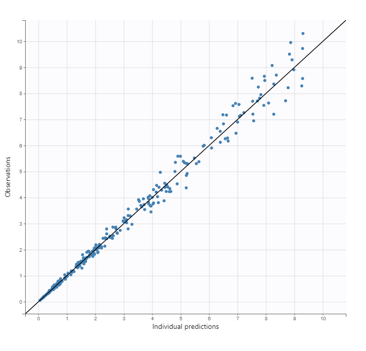

Observed versus individual predictions of concentration (µg/mL).
:::

::: {#fig-sketch-model}


Schematic representation of the one-compartment oral pharmacokinetic model with first-order absorption and elimination.
:::

### 4.2 Individual fits

The individual concentration–time profiles and their corresponding model fits for all 32 subjects evaluated in PKAnalix2024R1 are depicted in @fig-ca-individual-fits-1 through @fig-ca-individual-fits-8.

::::::::::: panel-tabset
## Subjects 1–4

::: {#fig-ca-individual-fits-1}
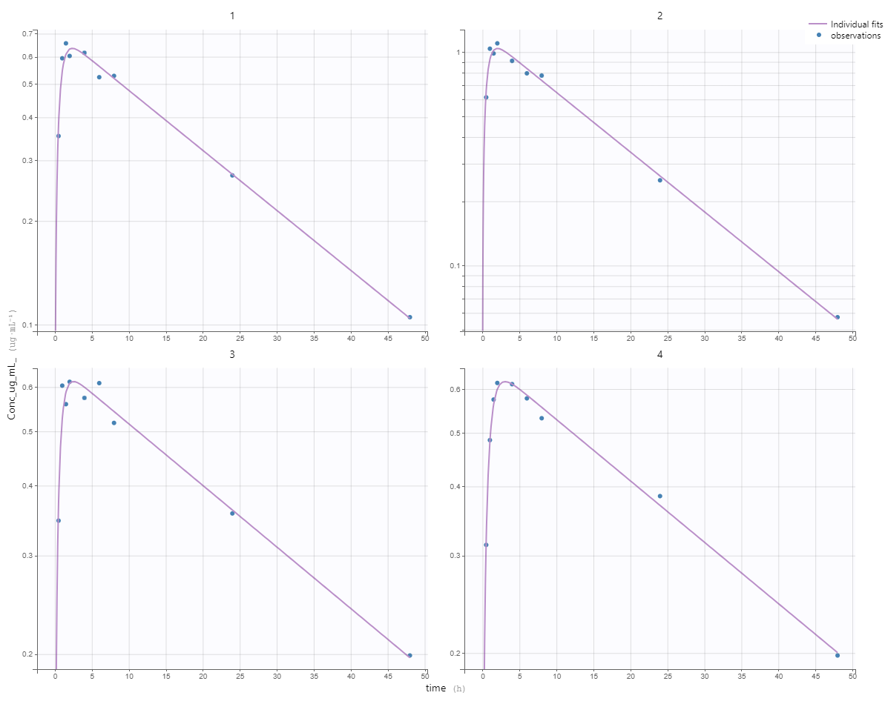

Terminal elimination phase regression fits for Subjects 1 to 4
:::

## Subjects 5–8

::: {#fig-ca-individual-fits-2}
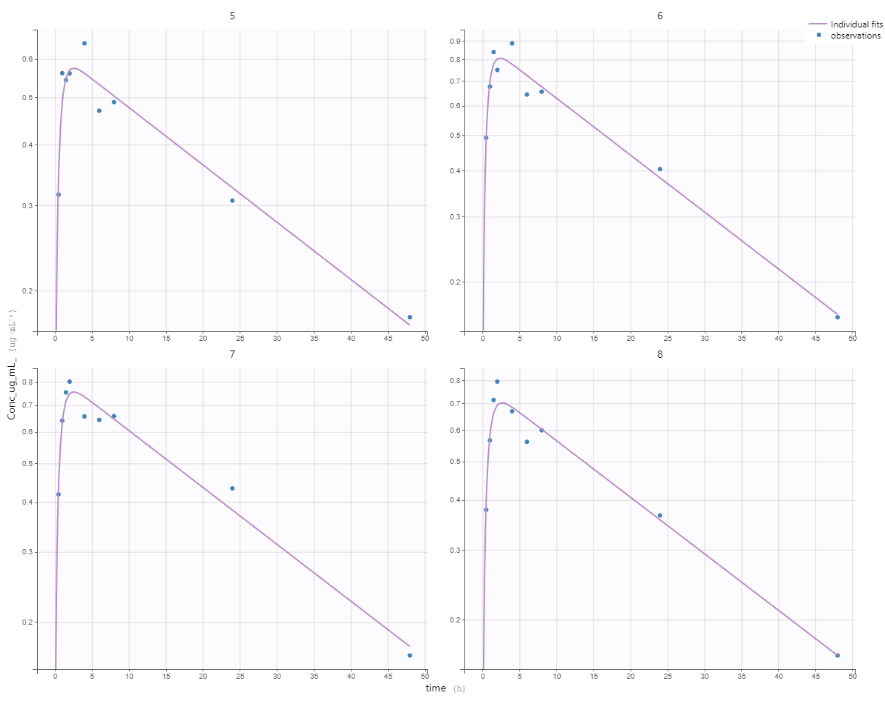

Terminal elimination phase regression fits for Subjects 5 to 8
:::

## Subjects 9–12

::: {#fig-ca-individual-fits-3}
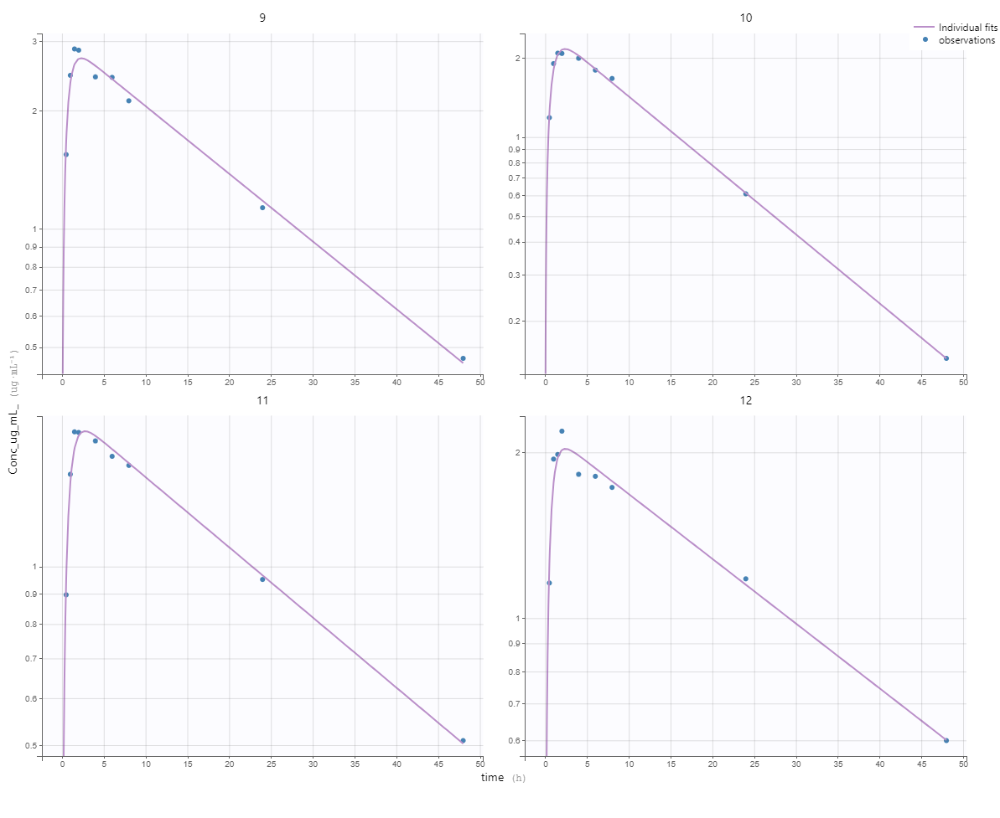

Terminal elimination phase regression fits for Subjects 9 to 12
:::

## Subjects 13–16

::: {#fig-ca-individual-fits-4}
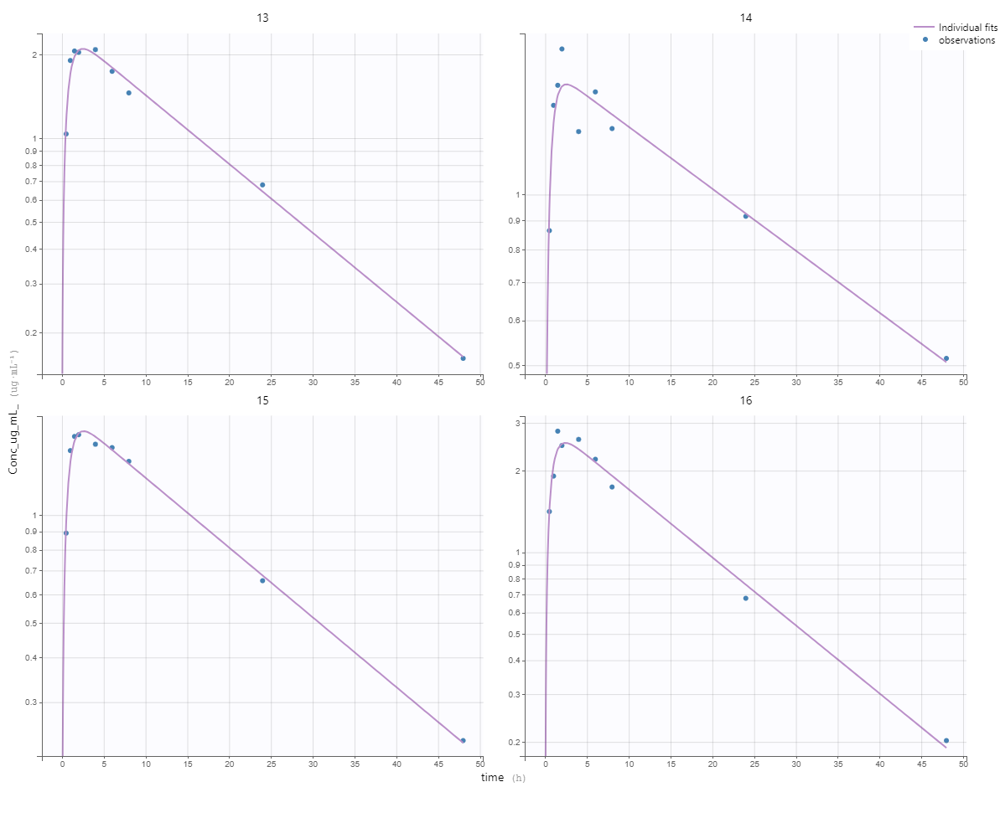

Terminal elimination phase regression fits for Subjects 13 to 16
:::

## Subjects 17–20

::: {#fig-ca-individual-fits-5}
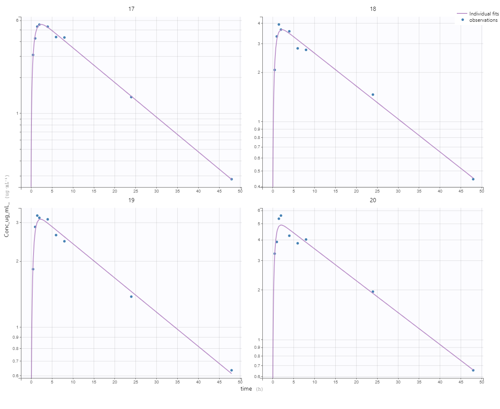

Terminal elimination phase regression fits for Subjects 17 to 20
:::

## Subjects 21–24

::: {#fig-ca-individual-fits-6}
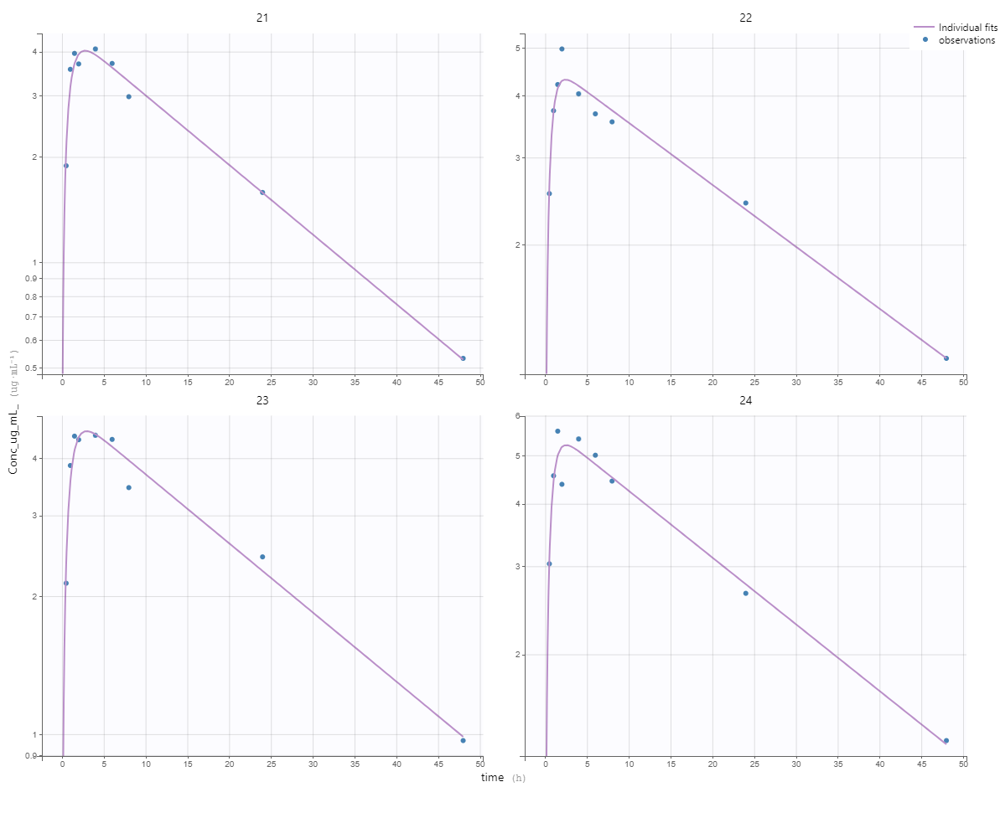

Terminal elimination phase regression fits for Subjects 21 to 24
:::

## Subjects 25–28

::: {#fig-ca-individual-fits-7}
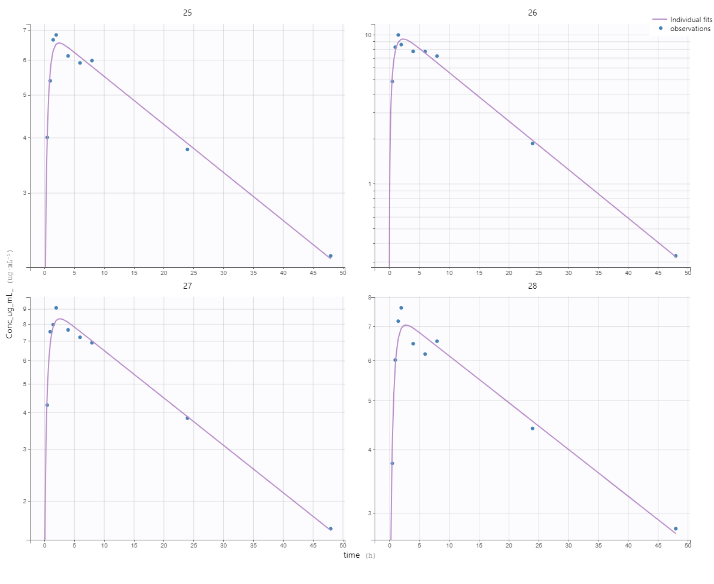

Terminal elimination phase regression fits for Subjects 25 to 28
:::

## Subjects 29–32

::: {#fig-ca-individual-fits-8}
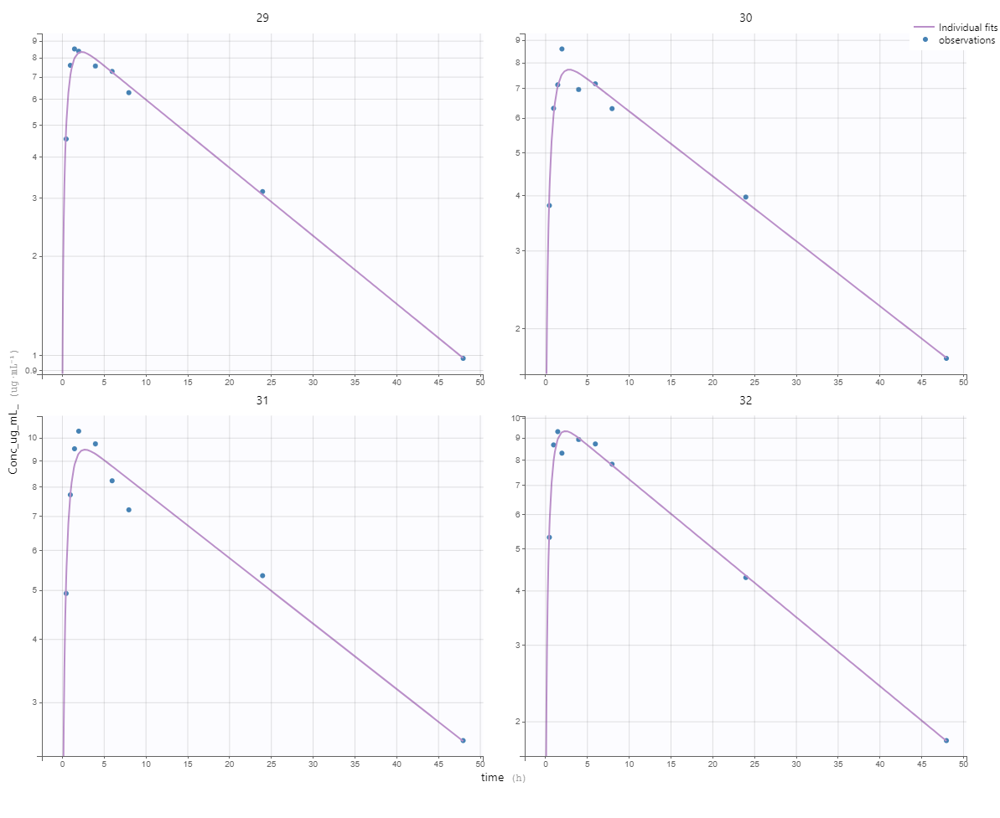

Terminal elimination phase regression fits for Subjects 29 to 32
:::
:::::::::::

## References

::: {#refs}
:::

## Software environment

Record the software and package versions used to produce the report.

```{r}
#| label: session-info
sessionInfo()
```
